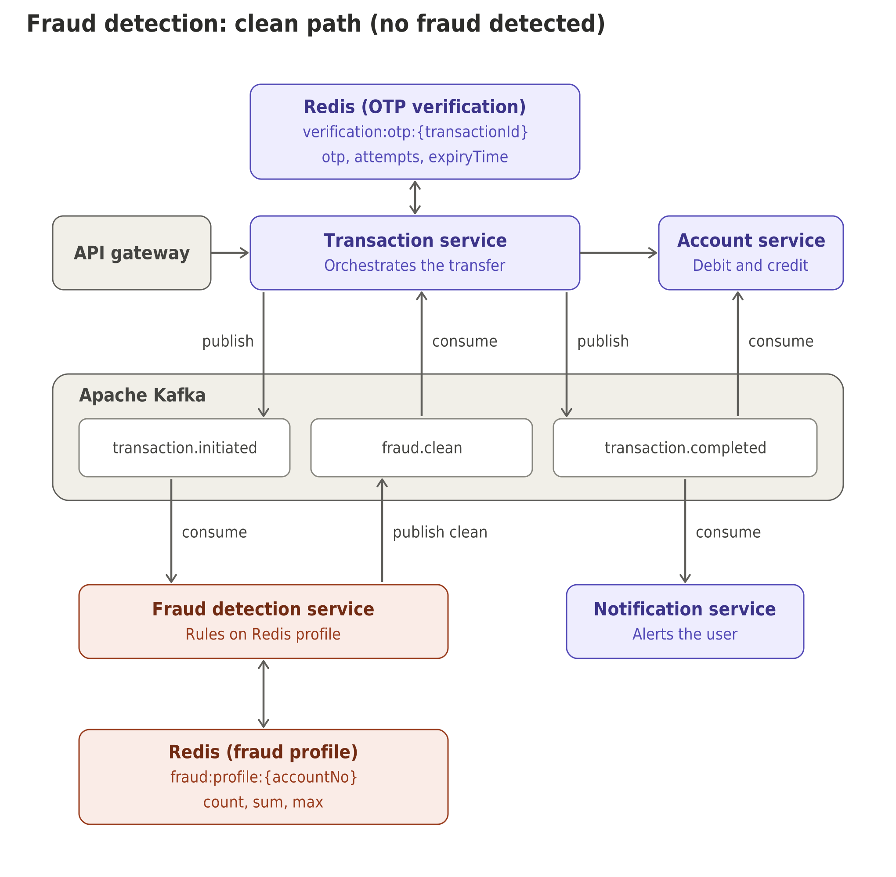
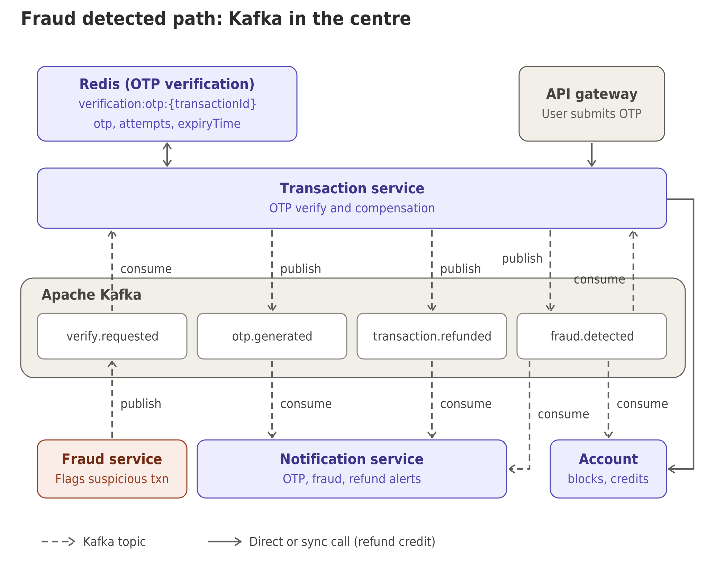

# 🏦 Banking Microservices Platform

A microservices banking backend that demonstrates event-driven architecture, distributed transaction management with the SAGA pattern, and secure payment flows. Built with Spring Boot 4 and Apache Kafka across six independent services, it covers account management, money transfers with real-time fraud detection, OTP-based step-up authentication, and Razorpay payment integration

---

## 📑 Table of Contents

- [Architecture Overview](#-architecture-overview)
- [Tech Stack](#-tech-stack)
- [Microservices](#-microservices)
  - [Account Service](#1-account-service-port-8081)
  - [Transaction Service](#2-transaction-service-port-8082)
  - [Payment Service](#3-payment-service-port-8083)
  - [Fraud Detection Service](#4-fraud-detection-service-port-8084)
  - [Notification Service](#5-notification-service)
  - [API Gateway](#6-api-gateway)
- [SAGA Transaction Flow](#-saga-transaction-flow)
- [Kafka Event Map](#-kafka-event-map)
- [API Reference](#-api-reference)
- [Getting Started](#-getting-started)
- [Configuration](#%EF%B8%8F-configuration)
- [Project Structure](#-project-structure)
- [Contributing](#-contributing)
- [License](#-license)

---

## 🏗 Architecture Overview

### 1. Normal Transaction Flow (No Fraud Detected)


### 2. Fraud Detection Flow (Fraud Detected via Kafka)


**Patterns Used:**
- **Event-Driven Architecture** — Kafka for asynchronous inter-service communication
- **SAGA choreography** — Compensating transactions for distributed data consistency
- **Synchronous Calls** — OpenFeign for real-time request/response between services
- **Layered Architecture** — Controller → Service → Repository → Entity per service

---

## 🛠 Tech Stack

| Category               | Technology                         |
|------------------------|------------------------------------|
| **Language**           | Java 21                            |
| **Framework**          | Spring Boot 4.1.1                  |
| **Cloud**              | Spring Cloud 2025.1.2              |
| **Build Tool**         | Apache Maven (Wrapper included)    |
| **Database**           | MySQL 8.x (JPA / Hibernate)        |
| **Message Broker**     | Apache Kafka 4.0.0 (KRaft mode, no ZooKeeper)|
| **Caching / OTP Store**| Redis (Spring Data Redis)          |
| **Payment Gateway**    | Razorpay (`razorpay-java 1.4.8`)   |
| **API Gateway**        | Spring Cloud Gateway (WebMVC)      |
| **Inter-Service Comm.**| OpenFeign (sync) + Kafka (async)   |
| **Object Mapping**     | ModelMapper 3.2.0                  |
| **Validation**         | Jakarta Bean Validation            |
| **Monitoring**         | Spring Boot Actuator               |
| **Containerization**   | Docker Compose                     |

---

## 🔧 Microservices

### 1. Account Service (Port 8081)

Manages bank accounts — creation, querying, balance operations, and account blocking.

**Key Features:**
- Create accounts with auto-generated **12-digit account numbers** (SecureRandom)
- Query account details and balance
- Deduct / credit balance (called by SAGA orchestration)
- Block accounts on fraud detection
- Kafka consumers for `transaction.completed` and `fraud.detected` events

**Account States:** `ACTIVE` · `BLOCKED` · `CLOSED` · `PENDING`

---

### 2. Transaction Service (Port 8082)

Orchestrates money transfers using the **SAGA pattern** with OTP-based step-up authentication for suspicious transactions.

**Key Features:**
- SAGA-choreography transfers (deduct → fraud check → complete/refund)
- OTP verification via Redis (5-minute TTL)
- Automatic **compensating transactions** (refunds) on OTP expiry or failure
- Account blocking on incorrect OTP
- Transaction history per account

**Transaction Types:** `TRANSFER` · `DEPOSIT` · `WITHDRAWAL` · `PAYMENT`
**Transaction States:** `PENDING` · `PROCESSING` · `PENDING_VERIFICATION` · `COMPLETED` · `FAILED` · `FLAGGED`

---

### 3. Payment Service (Port 8085)
Handles payment processing through the **Razorpay** payment gateway.

**Key Features:**
- Create Razorpay payment orders
- Webhook handler for Razorpay callbacks (`payment.captured`, `payment.failed`)
- Publishes `payment.completed` / `payment.failed` Kafka events

**Payment States:** `CREATED` · `PENDING` · `COMPLETED` · `FAILED` · `REFUNDED`

---

### 4. Fraud Detection Service (Port 8083)

Real-time fraud analysis with **three detection patterns**, consuming transaction events from Kafka.

| Pattern                   | Rule                                              | Default Threshold |
|---------------------------|---------------------------------------------------|-------------------|
| **Velocity Check**        | Max transactions per minute (Redis counter + TTL) | 5 / min           |
| **Amount Anomaly Check**  | Flags if amount > N× running average (Redis)      | 3.0×              |
| **Balance % Check**       | Flags if amount > X% of account balance (Feign)   | 90%               |

Publishes `verification.required` (suspicious) or `fraud.check.clean` (clean) events.

---

### 5. Notification Service (Port 8084)

Event-driven notification hub — consumes events from all services and dispatches alerts.

**Supported Events:**
- `transaction.completed` → Debit / Credit alerts
- `payment.completed` / `payment.failed` → Payment alerts
- `fraud.detected` → Account blocked alert
- `transaction.otp.generated` → OTP delivery alert
- `transaction.refunded` → Refund confirmation

> **Note:** Currently logs to console. Email integration is dependency-ready (`spring-boot-starter-mail`) but not yet implemented.

---

### 6. API Gateway

Spring Cloud Gateway (WebMVC) entry point with Redis-reactive support for rate limiting.

> **Note:** Currently in early setup — route configuration is pending.

---

## 🔄 SAGA Transaction Flow

```
  Client                Transaction        Account         Fraud Detection      Notification
    │                    Service           Service            Service              Service
    │                       │                 │                  │                    │
    │──POST /transfer──────►│                 │                  │                    │
    │                       │──Feign:deduct──►│                  │                    │
    │                       │◄──200 OK────────│                  │                    │
    │                       │                 │                  │                    │
    │                       │──Kafka: transaction.initiated────►│                    │
    │                       │                 │                  │                    │
    │                       │                 │    ┌─────────────┤                    │
    │                       │                 │    │ 3 Checks:   │                    │
    │                       │                 │    │ • Velocity  │                    │
    │                       │                 │◄───┤ • Anomaly   │                    │
    │                       │                 │    │ • Balance % │                    │
    │                       │                 │    └─────────────┘                    │
    │                       │                 │                  │                    │
    │              ┌────────┴────────┐        │                  │                    │
    │              │   CLEAN         │  SUSPICIOUS               │                    │
    │              │                 │        │                  │                    │
    │    Kafka: fraud.check.clean   Kafka: verification.required│                    │
    │              │                 │        │                  │                    │
    │              ▼                 ▼        │                  │                    │
    │    Complete transfer    Generate OTP    │                  │                    │
    │    Kafka: txn.completed  Store in Redis │                  │                    │
    │              │           Kafka: otp.gen─┼──────────────────┼──────────────────►│
    │              │                 │        │                  │                    │
    │              │         ┌───────┴───────┐│                  │                    │
    │              │     OTP Correct    OTP Wrong/Expired        │                    │
    │              │         │               ││                  │                    │
    │              │    Complete         Refund + Block Account  │                    │
    │              │         │               ││                  │                    │
    │              ▼         ▼               ▼│                  │                    │
    │◄──Response───┘         └───────────────┘│                  │                    │
```

---

## 📨 Kafka Event Map

| Topic                      | Publisher            | Consumer(s)                        |
|----------------------------|----------------------|------------------------------------|
| `transaction.initiated`    | Transaction Service  | Fraud Detection Service            |
| `transaction.completed`    | Transaction Service  | Account Service, Notification      |
| `transaction.refunded`     | Transaction Service  | Notification Service               |
| `transaction.otp.generated`| Transaction Service  | Notification Service               |
| `verification.required`    | Fraud Detection      | Transaction Service                |
| `fraud.check.clean`        | Fraud Detection      | Transaction Service                |
| `fraud.detected`           | Transaction Service  | Account Service, Notification      |
| `payment.completed`        | Payment Service      | Notification Service               |
| `payment.failed`           | Payment Service      | Notification Service               |

---

## 📡 API Reference

### Account Service — `:8081`

| Method | Endpoint                                       | Description              |
|--------|-------------------------------------------------|--------------------------|
| `POST` | `/api/v1/accounts/`                            | Create new bank account  |
| `GET`  | `/api/v1/accounts/{accountNumber}`             | Get account details      |
| `GET`  | `/api/v1/accounts/{accountNumber}/balance`     | Get account balance      |
| `PUT`  | `/api/v1/accounts/{accountNumber}/block`       | Block an account         |
| `PUT`  | `/api/v1/accounts/{accountNumber}/deduct?amount=` | Deduct balance (SAGA) |
| `PUT`  | `/api/v1/accounts/{accountNumber}/credit?amount=` | Credit balance         |

### Transaction Service — `:8082`

| Method | Endpoint                                        | Description                     |
|--------|--------------------------------------------------|---------------------------------|
| `POST` | `/api/v1/transactions/transfer`                 | Transfer money between accounts |
| `GET`  | `/api/v1/transactions/{transactionId}`          | Get transaction by ID           |
| `GET`  | `/api/v1/transactions/account/{accountNumber}`  | Transaction history for account |

### Payment Service — `:8083`

| Method | Endpoint                       | Description                   |
|--------|--------------------------------|-------------------------------|
| `POST` | `/api/v1/payment/create-order` | Create Razorpay payment order |
| `POST` | `/api/v1/payment/webhook`      | Razorpay webhook callback     |

### Health Check — All Services

| Method | Endpoint           | Description      |
|--------|--------------------|------------------|
| `GET`  | `/actuator/health` | Health check     |
| `GET`  | `/actuator/info`   | Application info |

---

## Redis Design

The system uses two separate Redis instances. Each is owned by one service, and no other service reads or writes it.

| Instance | Owner service | Docker service | Host port | Purpose |
|---|---|---|---|---|
| Fraud Redis | Fraud service | `redis-fraud` | 6379 | Per-account transaction profile used by fraud checks |
| OTP Redis | Transaction service | `redis-otp` | 6380 | Temporary OTP state for verification |

Why two instances: each service owns its data, a failure in one store does not affect the other, and each can have its own memory and eviction settings.

### 1. Fraud Redis (Fraud service)

| Key | Type | TTL | Purpose |
|---|---|---|---|
| `fraud:profile:{accountNo}` | Hash | none | Running stats for one account |
| `fraud:processed:{transactionId}` | String | 24h | Idempotency marker, prevents counting a transaction twice |

Fields of `fraud:profile:{accountNo}`:

| Field | Type | Meaning |
|---|---|---|
| `count` | integer | Number of completed transactions |
| `sum` | integer (paise) | Total amount sent |
| `max` | integer (paise) | Largest single transaction |

Amounts are stored in paise (integers) to avoid floating-point errors. Average amount = `sum / count`.

**Read (on `transaction.initiated`):**
```
HGETALL fraud:profile:{accountNo}
```
A missing key means a new account with no history.

**Update (only on the clean path, after `fraud.clean`):** one atomic Lua script that is also idempotent.
```lua
-- KEYS[1] = fraud:profile:{accountNo}
-- KEYS[2] = fraud:processed:{transactionId}
-- ARGV[1] = amount in paise, ARGV[2] = marker TTL in seconds (86400)
local first = redis.call('SET', KEYS[2], '1', 'NX', 'EX', ARGV[2])
if not first then return 0 end                       -- already counted
redis.call('HINCRBY', KEYS[1], 'count', 1)
redis.call('HINCRBY', KEYS[1], 'sum', ARGV[1])
local max = tonumber(redis.call('HGET', KEYS[1], 'max') or '0')
if tonumber(ARGV[1]) > max then redis.call('HSET', KEYS[1], 'max', ARGV[1]) end
return 1
```
Redis has no atomic "set if greater", so the script is needed to update `max` safely under concurrent transactions.

**Settings:** `appendonly yes`, `maxmemory-policy noeviction` (profiles must never be silently evicted).

### 2. OTP Redis (Transaction service)

| Key | Type | TTL | Purpose |
|---|---|---|---|
| `verification:otp:{transactionId}` | Hash | 5 minutes | OTP state for one transaction |

Fields:

| Field | Type | Meaning |
|---|---|---|
| `otp` | string | HMAC-SHA256 hash of the OTP (never the plain OTP) |
| `attempts` | integer | Number of wrong attempts so far |
| `expiryTime` | epoch millis | Expiry timestamp, for display and logs |

The key TTL is what actually expires the OTP, so no cleanup job is needed.

**Create (on `verify.requested`):**
```
HSET verification:otp:{transactionId} otp <hash> attempts 0 expiryTime <epochMillis>
EXPIRE verification:otp:{transactionId} 300
```


| Script result | Action in Transaction service |
|---|---|
| `VERIFIED` | Continue the transaction |
| `WRONG` | Return an error to the user, they can retry |
| `LOCKED` | Publish `fraud.detected` (starts compensation) |
| `EXPIRED` | Ask the user to request a new OTP |

**Settings:** `appendonly yes`, `maxmemory-policy volatile-ttl` (every key has a TTL).

### Failure handling

| Failure | Behaviour |
|---|---|
| Fraud Redis down | Fraud service falls back to rules-only decisions, or fails closed (sends the transaction to OTP) |
| OTP Redis down | Verification cannot proceed, return a retryable error. Do NOT treat it as fraud |
| Fraud Redis data lost | Profiles rebuild from new transactions. Until then, new-account rules apply |
| Duplicate Kafka event | Handled by `fraud:processed:{transactionId}` |

### Quick test with redis-cli
```bash
# Fraud Redis
docker exec -it fraud-redis redis-cli
HSET fraud:profile:ACC1001 count 5 sum 2500000 max 900000
HGETALL fraud:profile:ACC1001

# OTP Redis
docker exec -it otp-redis redis-cli
HSET verification:otp:TXN1 otp abc123hash attempts 0 expiryTime 1700000000000
EXPIRE verification:otp:TXN1 300
TTL verification:otp:TXN1
```
----
## 🚀 Getting Started

### Prerequisites

| Requirement        | Version   |
|--------------------|-----------|
| Java               | 21+       |
| Maven              | 3.9+ (or use included `mvnw`) |
| MySQL              | 8.x       |
| Redis              | 7.x+      |
| Docker & Compose   | Latest    |

### 1. Start Infrastructure (Kafka)

```bash
docker-compose up -d
```

This starts:
- **Kafka** (KRaft mode) on `localhost:29092`
- **Kafka UI** on `http://localhost:8090`

### 2. Create MySQL Databases

```sql
CREATE DATABASE account_db;
CREATE DATABASE transaction_db;
CREATE DATABASE payment_db;
```

### 3. Ensure Redis Is Running

```bash
redis-server
```

### 4. Build All Services

```bash
# From the project root — build each service
cd account-service       && ./mvnw clean package -DskipTests && cd ..
cd transaction-service   && ./mvnw clean package -DskipTests && cd ..
cd fraud-detection-service && ./mvnw clean package -DskipTests && cd ..
cd notification-service  && ./mvnw clean package -DskipTests && cd ..
cd payment-service       && ./mvnw clean package -DskipTests && cd ..
cd api-gateway           && ./mvnw clean package -DskipTests && cd ..
```

### 5. Run Services (each in a separate terminal)

```bash
cd account-service         && ./mvnw spring-boot:run
cd transaction-service     && ./mvnw spring-boot:run
cd fraud-detection-service && ./mvnw spring-boot:run
cd notification-service    && ./mvnw spring-boot:run
cd payment-service         && ./mvnw spring-boot:run
cd api-gateway             && ./mvnw spring-boot:run
```

> **Windows users:** Use `mvnw.cmd` instead of `./mvnw`.

### 6. Verify

```bash
curl http://localhost:8081/actuator/health
curl http://localhost:8082/actuator/health
curl http://localhost:8083/actuator/health
curl http://localhost:8084/actuator/health
```

---

## ⚙️ Configuration

### Environment Variables

| Variable                 | Service(s)                   | Description                                   |
|--------------------------|------------------------------|-----------------------------------------------|
| `JDBC_DATABASE_URL`      | Account, Transaction, Payment| MySQL JDBC URL                                |
| `JDBC_DATABASE_USERNAME` | Account, Transaction, Payment| MySQL username                                |
| `JDBC_DATABASE_PASSWORD` | Account, Transaction, Payment| MySQL password                                |
| `ACCOUNT_SERVICE_URL`    | Transaction                  | Account service URL (default: `http://localhost:8081`) |
| `KAFKA_BOOTSTRAP_SERVERS`| Payment                      | Kafka broker (default: `localhost:29092`)      |
| `RAZORPAY_KEY_ID`        | Payment                      | Razorpay API key                              |
| `RAZORPAY_KEY_SECRET`    | Payment                      | Razorpay API secret                           |
| `RAZORPAY_WEBHOOK_SECRET`| Payment                      | Razorpay webhook secret                       |

### Fraud Detection Thresholds

| Property                              | Default | Description                          |
|---------------------------------------|---------|--------------------------------------|
| `fraud.max-transactions-per-minute`   | `5`     | Max transactions before velocity flag|
| `fraud.suspicious-amount-multiplier`  | `3.0`   | Flag if amount > N× average          |
| `fraud.max-balance-percentage`        | `0.90`  | Flag if amount > 90% of balance      |

### Local Development Profile

All services are pre-configured with `application-local.yml` for local development:
- **MySQL:** `root` / `TestUser@123##` on `localhost:3306`
- **Kafka:** `localhost:29092`
- **Redis:** `localhost:6379`

---

## 📁 Project Structure

```
banking/
├── docker-compose.yml                  # Kafka + Kafka UI
│
├── account-service/                    # Port 8081
│   ├── pom.xml
│   └── src/main/java/com/banking/account_service/
│       ├── config/                     # Kafka, ModelMapper config
│       ├── controller/                 # REST endpoints
│       ├── dto/                        # Request/Response DTOs
│       ├── entity/                     # JPA entities
│       ├── repository/                 # Spring Data JPA repos
│       └── service/                    # Business logic
│
├── transaction-service/                # Port 8082
│   ├── pom.xml
│   └── src/main/java/com/banking/transaction_service/
│       ├── client/                     # Feign clients
│       ├── config/                     # Kafka, Redis, ModelMapper
│       ├── controller/
│       ├── dto/
│       ├── entity/
│       ├── event/                      # Kafka event models
│       ├── repository/
│       └── service/
│
├── fraud-detection-service/            # Port 8084
│   ├── pom.xml
│   └── src/main/java/com/banking/fraud_detection_service/
│       ├── client/                     # Feign clients
│       ├── config/
│       ├── model/                      # Detection models
│       └── service/
│
├── payment-service/                    # Port 8083
│   ├── pom.xml
│   └── src/main/java/com/banking/payment_service/
│       ├── config/                     # Razorpay config
│       ├── controller/
│       ├── dto/
│       ├── entity/
│       ├── repository/
│       └── service/
│
├── notification-service/
│   ├── pom.xml
│   └── src/main/java/com/banking/notification_service/
│       ├── config/
│       ├── service/
│       └── utils/
│
└── api-gateway/
    ├── pom.xml
    └── src/main/java/com/banking/api_gateway/
```

---

## 🤝 Contributing

1. Fork the repository
2. Create a feature branch (`git checkout -b feature/amazing-feature`)
3. Commit your changes (`git commit -m 'Add amazing feature'`)
4. Push to the branch (`git push origin feature/amazing-feature`)
5. Open a Pull Request

---

## 📄 License

This project is licensed under the [MIT License](LICENSE).

---

<p align="center">
  Built with ❤️ using Spring Boot, Kafka, and Microservices
</p>
